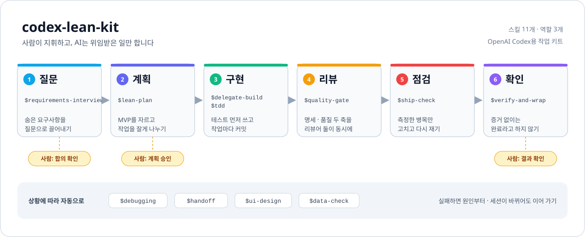

<div align="center">

# 🧰 codex-lean-kit

**AI가 코드를 써도, 일하는 순서는 사람이 지휘하게 만드는 OpenAI Codex 작업 키트**

<sub>개인 프로젝트 · 2026.10 · SK하이닉스 AI 해커톤에 쓰려고 만듦</sub>

<br/><br/>

<a href="GUIDE.md"></a>
<a href="LICENSE"></a>

<br/><br/>



</div>

<br/>

## 왜 만들었나

SK하이닉스 AI 해커톤을 준비하면서 만들었어요. AI로 일하는 실무 평가는 결과물만이 아니라 **일하는 과정**도 본다는 걸 공개 인터뷰, 공식 사이트, 대회 후기로 확인했어요.

그래서 앱 코드는 하나도 없고 **일하는 방식만 담은 키트**를 만들었어요. 원칙은 다섯 가지예요.

- 사람이 지휘하고 AI는 위임받은 일만 한다
- 숨은 요구사항은 질문으로 끌어낸다
- 테스트를 먼저 쓴다
- 증거 없이 완료라고 말하지 않는다
- 과설계하지 않는다

## 어떻게 쓰나

작업 공간 루트에서 한 번 설치하고 Codex를 켜요.

```sh
git clone --depth 1 https://github.com/Ju-unn/codex-lean-kit /tmp/kit
sh /tmp/kit/install.sh
codex -m gpt-6.1-sol -c model_reasoning_effort="medium" --disable computer_use --disable browser_use
```

- 설치하면 `AGENTS.md`, `.agents/skills/`(스킬 11개), `.codex/agents/`(역할 3개)가 생겨요. 기존 파일은 덮어쓰지 않아요.
- 단계 스킬(질문 → 계획 → 구현 → 리뷰 → 점검 → 확인)은 Codex가 다음 단계를 제안하면 **사람이 정해요**.
- 상황 스킬(`$tdd`, `$debugging`, `$handoff`, `$ui-design`, `$data-check`)은 필요할 때 Codex가 알아서 써요.
- 처음이라면 **[사용 설명서(GUIDE.md)](GUIDE.md)** 부터 보세요.

## 내가 한 것

- **공개 스킬을 Codex용으로 옮겼어요.** obra/superpowers, mattpocock/skills 같은 원본의 핵심 절차(철칙, 단계, 경고 신호)는 그대로 두고, Codex에서 안 되는 부분 · 시험 규정 · 시간 제한에 맞는 부분만 고쳤어요.
- **역할마다 모델을 나눴어요.** 읽기만 하는 탐색은 싼 모델(가격 1/20)에 맡기고, 구현과 리뷰는 강한 모델에 맡겨요. 역할 파일로 모델을 고정해서 허용되지 않은 모델은 쓸 수 없어요.
- **리뷰를 두 축으로 나눴어요.** 명세 축과 품질 축(보안 · DB · 과설계) 리뷰어 둘이 동시에 보고, 구체적인 사례가 있는 결함만 보고해요.
- **Codex에서 직접 재 봤어요.** (0.165.0, 2026-10-29) 신뢰하지 않은 폴더에서는 역할이 로드되지 않는 것을 확인하고, 그럴 때 쓸 대안을 키트에 넣었어요.
- **키트 자체를 시험해요.** `python tests/check_kit.py` 가 모델 허용 목록, 스킬 형식, 줄바꿈(LF), 설치 스크립트(빈 폴더와 기존 파일이 있는 폴더에서 각각 2번)를 확인해요.

<br/>

  -3776AB?style=flat-square&logo=python&logoColor=white) 

## 더 알아보기

- 📘 [사용 설명서: 설치, 작업 순서, 상황별 스킬](GUIDE.md)
- 🧩 [키트 상세: 만든 이유, 스킬 11개와 원본, 역할과 모델, 문제가 생기면](docs/키트_상세.md)
- 📜 [원본 라이선스 고지](THIRD_PARTY_NOTICES.md) · [MIT License](LICENSE)

---

<sub>만든 사람 [@Ju-unn](https://github.com/Ju-unn)</sub>
